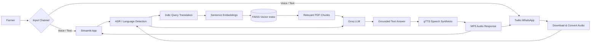

# 🌾 KisanVani

### Dual-Channel Multilingual Voice-First Agricultural Assistant Powered by Retrieval-Augmented Generation

[](https://www.python.org/)
[](https://fastapi.tiangolo.com/)
[](https://streamlit.io/)
[](https://www.twilio.com/)
[](https://groq.com/)

**KisanVani** helps farmers get clear, multilingual agricultural guidance through **voice or text**. It combines:

- A conversational **Streamlit web portal**
- A **Twilio WhatsApp** voice-and-text channel
- **Groq Whisper** for speech recognition
- **Retrieval-Augmented Generation (RAG)** over agricultural PDFs
- **gTTS** for natural multilingual audio responses

The assistant can answer in **English, Hindi, and Marathi**, keeping replies grounded in the project’s indexed agricultural documents.

---

## ✨ Key Features

- 🎙️ **Voice-first experience** - Record a question or send a WhatsApp voice note.
- 💬 **Text fallback** - Ask through the web chat or WhatsApp.
- 🌐 **Multilingual support** - Automatic language detection for Marathi, Hindi, English, and other supported TTS languages.
- 📚 **Document-grounded answers** - Retrieves evidence from FAISS-indexed agricultural PDFs.
- 🔊 **Text-to-speech replies** - Returns both text and downloadable/streamable MP3 audio.
- 📱 **Dual access channels** - Use the browser portal or WhatsApp.
- 🔄 **Knowledge-base rebuilding** - Re-index the PDFs directly from the Streamlit sidebar.
- 🧹 **Automatic cleanup** - Removes expired temporary and generated audio files.

---

## 🖼️ Access Channels

| Web Channel | WhatsApp Channel |
|---|---|
| Streamlit chat interface | Twilio WhatsApp webhook |
| Browser microphone recording | Incoming voice notes |
| Typed queries | Typed WhatsApp messages |
| Automatic or manual language choice | Automatic language detection |
| Embedded MP3 responses | Text plus MP3 media reply |

---

## 🧠 How It Works



### Processing Pipeline

1. Accept voice or typed input through Streamlit or WhatsApp.
2. Transcribe voice with Groq Whisper and detect the language.
3. Translate/transcribe Indic search queries for accurate retrieval.
4. Convert the query and PDF chunks into multilingual embeddings.
5. Retrieve the most relevant chunks from FAISS.
6. Generate a concise response from the retrieved context using Groq.
7. Convert the answer into speech and return it as text and/or audio.

---

## 🛠️ Technology Stack

| Area | Technologies |
|---|---|
| Web interface | Streamlit |
| API server | FastAPI, Uvicorn |
| Messaging | Twilio WhatsApp API |
| Speech-to-text | Groq Whisper |
| Embeddings | `paraphrase-multilingual-MiniLM-L12-v2` |
| Vector search | FAISS |
| Document processing | PyMuPDF |
| Response generation | Groq `openai/gpt-oss-120b` |
| Text-to-speech | gTTS |
| Audio conversion | PyDub, FFmpeg |
| Configuration | python-dotenv |

---

## 📂 Project Structure

```text
KisanVani/
├── streamlit_app.py          # Streamlit web portal
├── requirements.txt          # Python dependencies
├── ngrok.exe                 # Optional local public-tunnel executable
├── app/
│   ├── main.py               # FastAPI application
│   ├── api/
│   │   └── webhook.py        # Twilio/WhatsApp webhook and reply pipeline
│   ├── core/
│   │   └── config.py         # Shared configuration module
│   └── services/
│       ├── asr.py            # Groq Whisper transcription
│       ├── audio.py          # Twilio media download and conversion
│       ├── rag.py            # PDF indexing and FAISS retrieval
│       ├── llm.py            # Grounded response generation
│       ├── tts.py            # Text-to-speech synthesis
│       └── twilio_client.py  # Twilio client helpers
└── data/
    ├── documents/            # Agricultural source PDFs
    ├── vector_db/            # Generated FAISS index and chunks
    ├── temp_audio/           # Temporary voice downloads
    └── output_audio/         # Generated MP3 responses
```

---

## 🚀 Getting Started

### 1. Prerequisites

- Windows 10/11
- Python 3.10 or later
- FFmpeg available on `PATH`
- A Groq API key
- A Twilio account and WhatsApp-enabled Twilio number, for WhatsApp access

### 2. Clone the Repository

```powershell
git clone https://github.com/shivraj-nalawade/KisanVani.git
cd KisanVani
```

### 3. Create a Virtual Environment

```powershell
py -3.12 -m venv venv
.\venv\Scripts\Activate.ps1
python -m pip install --upgrade pip
pip install -r requirements.txt
```

If Python 3.12 is unavailable, use any supported Python version:

```powershell
py -m venv venv
```

### 4. Configure Environment Variables

Create a `.env` file in the project root:

```dotenv
GROQ_API_KEY=your_groq_api_key
TWILIO_ACCOUNT_SID=your_twilio_account_sid
TWILIO_AUTH_TOKEN=your_twilio_auth_token
TWILIO_PHONE_NUMBER=whatsapp:+your_twilio_number
NGROK_URL=https://your-public-url.ngrok-free.app
```

Never commit real API keys or Twilio credentials. The repository `.gitignore` excludes `.env` and generated data.

> **Security notice:** If credentials have already been shared or committed anywhere, revoke and rotate them before deployment.

### 5. Prepare the Knowledge Base

Place agricultural PDF files in `data/documents/`. The application automatically creates:

- `data/vector_db/faiss_index.bin`
- `data/vector_db/chunks.pkl`

You can also use **Rebuild Knowledge Base** in the Streamlit sidebar.

---

## ▶️ Running the Application

### Streamlit Web Portal

```powershell
streamlit run streamlit_app.py
```

Open the URL shown by Streamlit, usually `http://localhost:8501`.

### FastAPI + WhatsApp Webhook

Start the API server:

```powershell
python -m uvicorn app.main:app --reload --host 0.0.0.0 --port 8000
```

The health endpoint is available at:

```text
http://localhost:8000/
```

### Expose the Webhook for Twilio

If `ngrok.exe` is in the project root:

```powershell
.\ngrok.exe http 8000
```

Set `NGROK_URL` in `.env` to the generated HTTPS URL, then configure your Twilio WhatsApp webhook:

```text
https://your-public-url.ngrok-free.app/webhook
```

Use `POST` as the HTTP method.

---

## 💬 Example Questions

### English

> “What is the recommended pest management for pink bollworm in cotton?”

### हिंदी

> “सोयाबीन में पत्तियों पर पीले धब्बे क्यों आते हैं?”

### मराठी

> “कापसाच्या पिकासाठी गुलाबी बोंड अळीचे नियंत्रण कसे करावे?”

---

## 📖 Knowledge Sources

The repository currently includes PDFs covering:

- Amravati agricultural guidance
- Cotton and pink bollworm pest management
- Maharashtra farming practices
- Soybean cultivation
- Frequently asked agricultural questions

Place your own approved, location-specific PDFs in `data/documents/` and rebuild the vector database after adding or updating them.

---

## ⚙️ Configuration Notes

- The default FAISS chunk size is **150 words** with a **30-word overlap**.
- The web interface searches for the top **5** relevant chunks.
- ASR uses Groq Whisper model `whisper-large-v3-turbo`.
- Response generation uses `openai/gpt-oss-120b`.
- Responses are generated only from retrieved document context.
- Expired temporary files are cleaned periodically by the webhook pipeline.

---

## 🤝 Contributing

Contributions are welcome.

1. Fork the repository.
2. Create a feature branch.
3. Make and test your changes.
4. Open a pull request with a clear description.

Please do not commit `.env`, generated audio, vector databases, virtual environments, or local tunnel credentials.

---

## ⚠️ Disclaimer

KisanVani provides informational agricultural guidance based on indexed project documents. It does not replace a qualified agronomist or local agricultural expert. Verify recommendations for local weather, soil conditions, crop stage, pesticide restrictions, and regional regulations.

---

## 👨‍🌾 Vision

KisanVani aims to make trusted agricultural information accessible to every farmer—regardless of language, literacy level, or device type.
